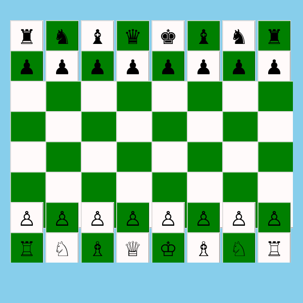

# NAMCHESS — Tkinter Chess Prototype



NAMCHESS is a small two-player chess prototype built with Python and Tkinter. It was created as a learning project to practise graphical interfaces, two-dimensional lists, state management, and move-validation logic.

> **Status: learning prototype, not a complete chess implementation.** The current baseline supports basic board interaction and several piece movements, but it does not enforce every official chess rule.

## Features

- An 8 × 8 chessboard rendered with Tkinter buttons.
- Unicode chess symbols for the pieces.
- Alternating turns for White and Black.
- Basic movement and capture logic for the implemented pieces.
- Visual highlighting of the selected origin and destination squares.
- Pawn movement checks for forward moves, diagonal captures, and blocked two-square advances.

## Requirements

- Python 3
- Tkinter (usually included with standard Python installations; on some Linux distributions it must be installed separately)

No third-party Python packages are required by the current baseline.

## Run

From the project directory, run:

```bash
python main.py
```

On Windows, `py main.py` may be used if the Python launcher is installed.

## How to play

1. Click the piece you want to move.
2. Click the destination square.
3. The program accepts the move only if it passes the checks implemented for that piece.
4. Players alternate turns after accepted moves.

Some invalid moves may simply be ignored because this is an early prototype.

## Known limitations

This version is a work in progress. It does not yet reliably implement or enforce all of the following:

- Check and checkmate, including preventing a king from moving into check.
- Castling, en passant, and pawn promotion.
- Stalemate and draw conditions.
- Full legal-move validation and comprehensive error/status messages.
- Move history, undo, restart, or save/load.

Please treat it as an educational prototype, not as an authoritative chess arbiter.

## Project structure

```text
namchess-tkinter/
├── main.py
├── README.md
├── LICENSE
├── .gitattributes
├── .gitignore
├── archive/
│   ├── namchess-it1.py
│   ├── namchess-it2.py
│   ├── namchess-it3.py
│   └── namchess-it4.py
├── screenshots/
│   └── chess-board.png
├── docs/
│   ├── development-history.md
│   └── testing-notes.md
└── tests/
    ├── manual-test-checklist.md
    └── smoke_test.py
```

## Development notes

The original complete iterations are retained under `archive/` for reference. They are not all equally complete or reliable. `main.py` is the selected runnable baseline; `it3` and `it4` are experimental versions and need further debugging. The partial files `pcp` and `chknmt` are not standalone applications and are intentionally excluded.

Run the regression smoke tests with `python tests/smoke_test.py` from a desktop session. On Linux without a visible display, the script uses `xvfb-run` if it is installed. See [the development history](docs/development-history.md), [testing notes](docs/testing-notes.md), and [manual test checklist](tests/manual-test-checklist.md).
